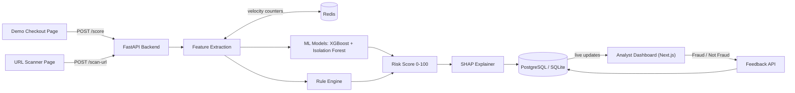
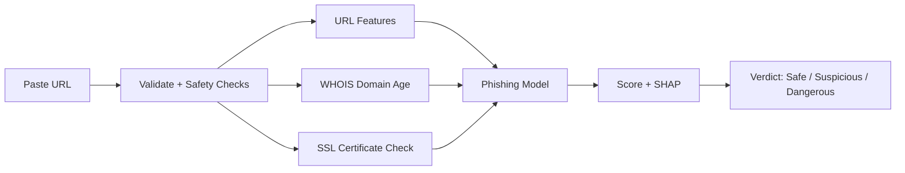

# 🛡️ FraudShield: AI-Driven Fraud Detection for E-commerce


**Mini Project | B.E. Computer Science & Engineering | VTU**

FraudShield is a real-time fraud detection system for e-commerce. It scores every transaction with machine learning, explains *why* it was flagged, scans suspicious **website URLs** for phishing and fake stores, and shows everything on a live analyst dashboard.

**Repository:** `https://github.com/navtejadcode/fraudshield`
**Repository owner / maintainer:** `<Your Name>` ([@navtejadcode](https://github.com/navtejadcode))

---

## 📌 Problem Statement

Online fraud causes huge losses for customers and merchants. Traditional rule-based systems are rigid, miss new fraud patterns, and block genuine customers. Fake shopping websites and phishing links make the problem worse.

**Objective:** Build an AI-driven system that detects fraudulent transactions and malicious websites in real time, explains its decisions, and helps analysts take quick action.

---

## ✨ Features

### Core
- **Transaction fraud detection:** XGBoost + Isolation Forest + rule engine, with a **risk score (0-100)** → ✅ Approve / 🔍 Review / ⛔ Block
- **URL / fake website scanner:** paste a link in the dashboard, get Safe / Suspicious / Dangerous with a red-flag checklist (the link is never opened in the browser)
- **Explainable AI:** SHAP charts show the top reasons behind every score
- **Live dashboard:** real-time feed, fraud alerts, manual review queue (Fraud / Not Fraud), analytics
- **Demo checkout page** and a **"Simulate Attack"** button

### Optional / Extended (tick as you finish)
- [ ] What-if simulator (sliders with live risk gauge)
- [ ] Model comparison page (Logistic Regression vs Random Forest vs XGBoost)
- [ ] World map of transactions
- [ ] Dark mode and role-based login (admin / analyst)
- [ ] Fake review detector
- [ ] SMS / email scam detector
- [ ] Seller trust score
- [ ] Telegram alerts
- [ ] Fraud ring graph
- [ ] AI explainer chatbot
- [ ] Chrome extension

---

## 🏗️ System Architecture



### URL Scanner Pipeline



---

## 🧰 Tech Stack

| Layer | Tools |
|---|---|
| Machine Learning | Python, Pandas, Scikit-learn, XGBoost, imbalanced-learn, SHAP |
| Backend | FastAPI, SQLAlchemy, Pydantic |
| URL Analysis | tldextract, python-whois, ssl/socket, requests, BeautifulSoup |
| Database | SQLite (or PostgreSQL), Redis (optional) |
| Frontend | Next.js, TypeScript, Tailwind CSS, Recharts |
| Version Control | Git, GitHub |

---

## 📁 Project Structure

```
fraudshield/
├── backend/
│   ├── app/
│   │   ├── main.py
│   │   ├── routes/        # score.py, scan_url.py, transactions.py, feedback.py
│   │   ├── services/      # features.py, url_features.py, rules.py, scoring.py, explain.py
│   │   └── db/
│   ├── ml/
│   │   ├── train_transaction.py
│   │   ├── train_url.py
│   │   └── artifacts/     # saved models
│   ├── tests/
│   └── requirements.txt
├── frontend/
│   ├── app/               # dashboard, checkout, url-scanner, review-queue, analytics
│   └── components/
├── data/                  # datasets (not committed, see below)
├── docs/                  # screenshots, diagrams
├── .env.example
├── .gitignore
└── README.md
```

---

## 🚀 Getting Started

### Prerequisites
Python 3.11+, Node.js 18+, Git

### 1. Clone the repository
```bash
git clone https://github.com/navtejadcode/fraudshield.git
cd fraudshield
```

### 2. Backend
```bash
cd backend
python -m venv venv
venv\Scripts\activate          # Windows (Mac/Linux: source venv/bin/activate)
pip install -r requirements.txt
cp .env.example .env           # fill in values
python -m ml.train_transaction # train transaction model
python -m ml.train_url         # train URL model
uvicorn app.main:app --reload
```
Backend: http://localhost:8000 | API docs: http://localhost:8000/docs

### 3. Frontend
```bash
cd frontend
npm install
npm run dev
```
Frontend: http://localhost:3000

### 4. Datasets
Datasets are **not stored in the repository** (large files). Download them into the `data/` folder:
- [Credit Card Fraud Detection (Kaggle)](https://www.kaggle.com/datasets/mlg-ulb/creditcardfraud)
- [Phishing Websites Dataset (UCI)](https://archive.ics.uci.edu/dataset/327/phishing+websites)

---

## 🌿 Git & GitHub Workflow

This project is version-controlled with Git and hosted on GitHub under the owner's account.

### Branching strategy
| Branch | Purpose |
|---|---|
| `main` | Stable, demo-ready code only |
| `develop` | Integration branch for ongoing work |
| `feature/<name>` | One branch per feature, e.g. `feature/url-scanner` |
| `fix/<name>` | Bug fixes |

### Daily workflow
```bash
git checkout develop
git pull origin develop
git checkout -b feature/url-scanner

# ... write code ...

git add .
git commit -m "feat: add URL feature extraction"
git push -u origin feature/url-scanner
```
Then open a **Pull Request** on GitHub into `develop`, review it, and merge. When `develop` is stable, merge it into `main`.

### Commit message convention
| Prefix | Use for |
|---|---|
| `feat:` | New feature |
| `fix:` | Bug fix |
| `docs:` | README / documentation |
| `refactor:` | Code cleanup |
| `test:` | Adding tests |
| `chore:` | Setup, dependencies |

Example: `feat: add SHAP explanation to /score endpoint`

### What is NOT committed (`.gitignore`)
```
venv/
__pycache__/
node_modules/
.next/
.env
data/*.csv
*.pkl
*.log
.DS_Store
```
**Never commit `.env`, API keys, or tokens.** Share `.env.example` instead.

### GitHub features used
- **Issues:** one issue per task or bug
- **Projects board:** To Do / In Progress / Done
- **Pull Requests:** review before merging to `develop`
- **Releases:** tag `v1.0` for the final exhibition version
- **Collaborators:** teammates added under *Settings → Collaborators*

### For teammates
1. Ask the repository owner to add you as a collaborator
2. Clone the repo and create your own `feature/` branch
3. Never push directly to `main`

---

## 🔌 API Endpoints

| Method | Endpoint | Description |
|---|---|---|
| POST | `/api/v1/score` | Score a transaction → risk score + decision + reasons |
| POST | `/api/v1/scan-url` | Scan a website URL → verdict + red flags |
| GET | `/api/v1/transactions` | List transactions |
| GET | `/api/v1/scans` | URL scan history |
| POST | `/api/v1/cases/{id}/feedback` | Analyst marks Fraud / Not Fraud |
| GET | `/api/v1/stream` | Live alerts (SSE) |
| GET | `/api/v1/metrics` | Model performance |

**Sample URL scan response**
```json
{
  "url": "http://amaz0n-offers-login.xyz/verify",
  "risk_score": 91,
  "verdict": "DANGEROUS",
  "red_flags": [
    "No HTTPS",
    "Domain registered 5 days ago",
    "Suspicious keywords: login, verify, offers",
    "Uncommon TLD (.xyz)"
  ]
}
```

---

## 🎯 Risk Scoring

| Score | Decision (Transaction) | Verdict (URL) |
|---|---|---|
| 0-29 | ✅ Approve | 🟢 Safe |
| 30-69 | 🔍 Manual Review | 🟡 Suspicious |
| 70-100 | ⛔ Block | 🔴 Dangerous |

Thresholds are configurable based on the business cost of false positives (blocking genuine customers) vs. false negatives (missing fraud).

---

## 📊 Model Evaluation

Accuracy alone is misleading because fraud is very rare in real data. We report:

| Metric | Transaction Model | URL Model |
|---|---|---|
| Precision | TBD | TBD |
| Recall | TBD | TBD |
| F1-Score | TBD | TBD |
| PR-AUC / ROC-AUC | TBD | TBD |

Confusion matrix and precision-recall curve are stored in `docs/`. *(Fill in after training.)*

---

## 🎬 Demo Scenarios

1. **Normal purchase:** small amount, known device, same country → ✅ Approve
2. **Suspicious purchase:** high amount, new country, new device → 🔍 Review
3. **Attack simulation:** 10 rapid transactions → ⛔ Block + live alerts
4. **Safe URL:** `https://www.amazon.in` → 🟢 Safe
5. **Fake URL:** a lookalike phishing-style link → 🔴 Dangerous

---

## 🗓️ Development Plan

- [ ] **Week 1:** Create GitHub repo, set up branches, datasets, EDA
- [ ] **Week 2:** Train transaction model (XGBoost + imbalance handling + SHAP)
- [ ] **Week 3:** FastAPI `/score`, rule engine, risk score
- [ ] **Week 4:** URL feature extraction + phishing model + `/scan-url`
- [ ] **Week 5:** Next.js dashboard: live feed, checkout page, URL scanner page
- [ ] **Week 6:** SHAP charts, review queue, simulate-attack button, extra features
- [ ] **Week 7:** Testing, bug fixes, evaluation charts
- [ ] **Week 8:** Report, PPT, demo video, tag release `v1.0`

---

## 🔒 Safety Notes (URL Scanner)

- Pasted links are never opened in the browser or executed
- Backend uses short timeouts and does not run JavaScript
- Private/internal IP addresses are blocked (SSRF protection)
- Results are predictions, not guarantees

---

## ⚠️ Limitations

- Trained on public datasets, not real merchant data
- URL checks like WHOIS and SSL need an internet connection
- Fraudsters change tactics, so models need periodic retraining

## 🚀 Future Scope

- Graph analysis to detect fraud rings
- Fake review and SMS scam detection
- Browser extension for real-time URL warnings
- Automatic retraining from analyst feedback
- Cloud deployment with Docker and CI/CD

---

## 👥 Team

| Name | USN | GitHub | Role |
|---|---|---|---|
| Your Name (Owner) | 1XX22CSXXX | [@navtejadcode](https://github.com/navtejadcode) | Repo owner, Backend + ML |
| Teammate | 1XX22CSXXX | [@teammate](https://github.com/teammate) | Frontend |

**Guide:** Prof. `<name>` | **College:** `<college name>` | **Year:** 2026

## 📄 License

MIT
